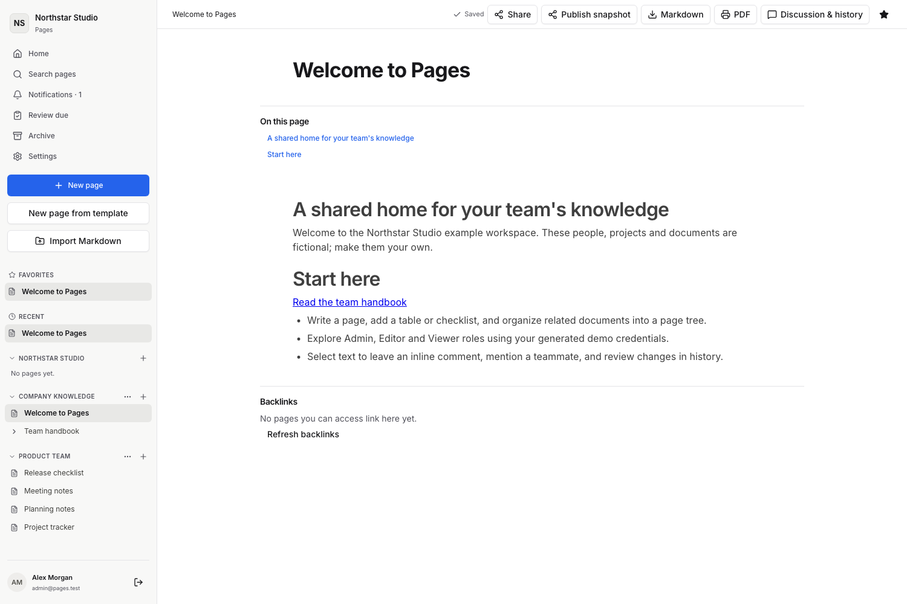

# Pages

An open-source team wiki inspired by Notion. Write rich pages, organize them in a
page tree and team spaces, and keep your team's knowledge, discussion and review
history together.

Pages is a [Neander](https://neander.ai) template application. Use its source to
start your own project, customize it and deploy through ordinary Publish. It is
MIT-licensed and independent of Notion.



## What is included

- A BlockNote editor with rich text, tables, nested pages and private attachments.
- Company workspaces, team spaces and Admin, Editor and Viewer roles.
- Page/space access grants, groups and inherited permissions enforced on the server.
- Inline and page discussions, mentions, notifications, search and review reminders.
- Version history, duplication, archive/restore and Markdown import/export.
- Explicit public page snapshots and browser Save as PDF; later private edits do
  not silently update a published snapshot.
- PostgreSQL migrations and fictional sample content with generated credentials.

Email delivery is optional and requires your own provider key and verified sender.
No shared mail account, provider credentials or live workspace data is included.
See [limitations](docs/limitations.md) and the [role matrix](docs/ROLE_MATRIX.md).

## Run locally

Use Node **24.22.3**, pnpm **11.18.0**, Docker and PostgreSQL. Tool versions are
pinned in `mise.toml`.

```sh
pnpm install --frozen-lockfile
docker compose -p pages-dev -f compose.dev.yaml up -d --wait
cp .env.example .env.local
```

The opt-in development database uses loopback port `55470`; check that it is free
or choose another port first. Its `pages_dev` / `pages_dev_only` credentials are
local fixtures. Generate your own strong `BETTER_AUTH_SECRET` and `DEMO_PASSWORD`
in the ignored `.env.local`; never reuse those fixture credentials in deployment.

```sh
pnpm db:migrate
pnpm db:seed
pnpm dev
```

Open `http://127.0.0.1:5173`. Sign in with the seeded `admin@pages.test`,
`editor@pages.test` or `viewer@pages.test` account and your generated
`DEMO_PASSWORD`. Initialization is explicit; repeating it preserves later edits
and passwords. You can also register a separate workspace with your own account.

Development and unit tests retain the existing embedded PGlite path when
`DATABASE_URL` is empty. Published deployments require PostgreSQL and run
migrations separately; production startup never applies schema changes.

## Develop and verify

```sh
pnpm verify
```

This runs TypeScript, the existing application tests, repository policy and the
production frontend build. Real-image, database and browser checks are described
in [testing](docs/testing.md). The standard unit suite alone does not prove the
native editor browser suite passed. Read [development](docs/development.md) for
the server layout, local email behavior and safe data handling.

## Deploy and customize

`.neander/compose.yaml` is the normal Neander publishing recipe: a Node runtime,
managed PostgreSQL, public origin binding, generated credentials and committed
Drizzle migrations. The runtime runs as an unprivileged user, requires HTTPS in
production and serves the frontend, API and public snapshots together.

`.neander/template.yaml` owns the library metadata, seed command and committed
gallery. Neander's private publisher verifies the exact GitHub commit, scans its
tested image and registers immutable image references and screenshots. Public app
CI has no cloud credentials or private publisher code. Source stays on GitHub;
template publication does not copy a live database or deploy a user application.

[Source attribution](docs/source-attribution.md) · [Security](SECURITY.md) · [MIT license](LICENSE)
